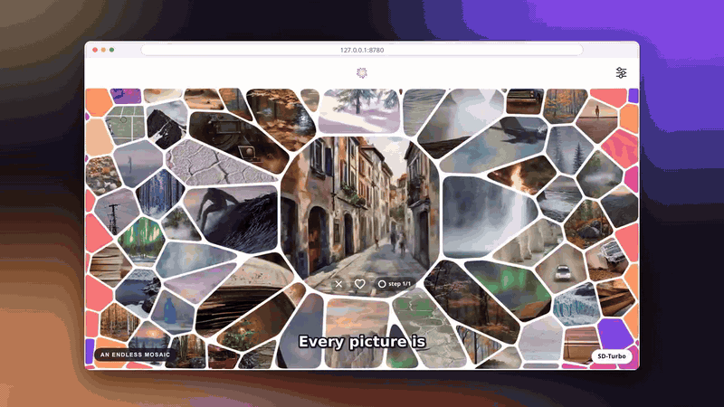

<p align="center">
  
</p>

<h1 align="center">Phosphene</h1>

<p align="center">
  An endless mosaic of pictures, drawn on your own graphics card while you look.<br>
  It learns what you like.
</p>

<p align="center">
  <a href="https://github.com/damiano1996/phosphene/actions/workflows/ci.yml"></a>
  <a href="https://github.com/damiano1996/phosphene/releases/latest"></a>
  <a href="LICENSE"></a>
  
  
</p>

<p align="center">
  <a href="docs/media/demo.mp4"></a><br>
  <sub><a href="docs/media/demo.mp4">Watch the full demo</a> (2.5 minutes, with voice)</sub>
</p>

## What it is

You drag over a mosaic that never ends. Every picture is made on the spot by an image model that runs on your GPU. What you go to, linger on, heart or cross out teaches the app your taste, and the pictures it makes next follow it.

- **Private.** Nothing you do leaves your computer. The engine listens on `127.0.0.1` only, behind a key. The only downloads are the runtime (once) and the models you pick.
- **Runs on a small card.** From SD-Turbo (about 3 GB of video memory) to FLUX.1 schnell, on a 4 GB laptop GPU. You choose the model that fits your hardware.
- **Learns without being told.** Pick a few categories you are curious about and look around. It finds a taste that crosses them, down to the finer kind of a thing (the Dolomites, not just "mountains") and to looks (golden hour, fog, pale rock).
- **Shows what it learned.** A map of your taste, the looks you favour, every signal it rests on. You can pause it, export it or forget it.
- **Extensible.** Add a model in a JSON file, a backend as a class, a picture reader as a catalogue entry ([docs/EXTENDING.md](docs/EXTENDING.md)).

## Download

| System | Download | Status |
|---|---|---|
| Ubuntu / Debian | [Phosphene-linux-amd64.deb](https://github.com/damiano1996/phosphene/releases/latest/download/Phosphene-linux-amd64.deb) | tested, NVIDIA card |
| Any Linux | [Phosphene-linux-x86_64.AppImage](https://github.com/damiano1996/phosphene/releases/latest/download/Phosphene-linux-x86_64.AppImage) | tested, NVIDIA card |

All releases: [github.com/damiano1996/phosphene/releases](https://github.com/damiano1996/phosphene/releases).

**Windows and macOS:** there is no installer yet. An unsigned installer is blocked or flagged by both systems, so it is not published until it is signed. The engine is written to run on both (Windows with an NVIDIA card; macOS with Apple Silicon), but neither has been tried yet. You can try [running from source](#run-from-source) and report what happens.

**What you need:** an NVIDIA graphics card with a recent driver (4 GB is enough for the small models). Windows and macOS have no installer yet (see above). About 10 GB of free disk for the install, plus the models you pick. A modern browser, tested in Chrome. You do not need Python, Node or uv: the installer brings what it needs.

## Install and run

1. **Open the installer.**
   - Ubuntu / Debian: `sudo apt install ./Phosphene-linux-amd64.deb`, then open **Phosphene** from the menu.
   - Other Linux: `chmod +x Phosphene-linux-x86_64.AppImage && ./Phosphene-linux-x86_64.AppImage`.
2. **Press Install, once.** It fetches Python, PyTorch and the engine into the app's own folder. This takes a few minutes and several GB. Nothing is installed system-wide.
3. **Press Launch.** Your browser opens on the page. The first run asks you to pick a model (the recommended one for your card is preselected), then what you are curious about, and draws the first pictures.

Press **Stop** or close the window to stop the engine. To start over, delete the app's folder, `~/.config/Phosphene`. How the installer works: [launcher/README.md](launcher/README.md).

### If something goes wrong

| What you see | What to do |
|---|---|
| "Something else is using the GPU" | Another program holds the video memory (a dictation app, a game, another model server). Close it, or pick a smaller model. The smallest needs about 3 GB free. |
| The install seems stuck on PyTorch | It is downloading several GB and prints nothing for a few minutes. The log shows "still working" every 15 seconds. |
| The install fails | Check you have 10 GB free. Press **Install** again: it starts clean. |
| The AppImage does not start | Install the `.deb` instead, or run it from a terminal to see the error. |
| "No supported graphics card found" | An NVIDIA card with its driver is needed (or a Mac with Apple Silicon, from source). |

Found a bug? [Open an issue](https://github.com/damiano1996/phosphene/issues/new/choose) with the log from the installer window.

## Models

Phosphene downloads a model once, from its original source, the first time you choose it. You can add more or delete them later in the app. Pick one that fits your card:

<!-- models:start -->
| Model | Download | GPU memory | Licence |
|---|---|---|---|
| **SD-Turbo** | 2.5 GB | 2.9 GB | Stability AI licence |
| **Stable Diffusion 1.5 + LCM** | 2.2 GB | 2.9 GB | CreativeML OpenRAIL-M |
| **SDXS-512 DreamShaper** | 1.8 GB | 1.5 GB | OpenRAIL++ |
| **SDXL-Turbo** | 6.8 GB | 3.3 GB | Stability AI licence |
| **RealVisXL V5 Lightning** | 6.8 GB | 3.3 GB | OpenRAIL++ |
| **DreamShaper XL Lightning** | 6.8 GB | 3.3 GB | OpenRAIL++ |
| **SANA Sprint 1.6B** | 9.5 GB | 2.7 GB | Apache 2.0 |
| **FLUX.1 schnell** | 16.5 GB | 2.2 GB | Apache 2.0 |
<!-- models:end -->

**The models are not part of this repository and keep their own licences.** Some restrict commercial use of the pictures they draw. Check a model's terms before you use its pictures commercially. Each model's card in the app links to its page.

## How it works

```
 browser (web/)  ──── localhost, key ────▶  engine (engine/, Python + PyTorch)
 the mosaic, the recommender,                one picture per request, from the model on your GPU
 the screens; plain ES modules               models, downloads, the optional reader of pictures
```

The mosaic is an endless spiral of cells. Each cell is a point on a map of 526 concepts (`atlas/`) plus a **seed** that also says which finer kind of the concept and which looks to ask for. A taste model (a Gaussian-process preference model fitted from your choices, sampled by Thompson sampling) decides what the next cells are. An optional small model reads the pictures, so the app learns from what a picture shows and not only from what was asked.

More: [docs/ARCHITECTURE.md](docs/ARCHITECTURE.md), and what it builds on: [ADR 0009](docs/adr/0009-prior-art.md).

## Run from source

For development, or if you prefer a terminal. You need [uv](https://docs.astral.sh/uv/).

```bash
git clone https://github.com/damiano1996/phosphene.git && cd phosphene
(cd engine && UV_HTTP_TIMEOUT=1200 uv sync)      # once; the long timeout keeps the big PyTorch download from failing
scripts/web.sh                                    # starts the engine, which serves the page, and opens it
```

The page is at `http://127.0.0.1:8780/`. The link printed at start contains the key, and opening that link once lets your browser in. Run from source, your data is kept in `~/.local/share/phosphene` (`--data-dir` changes it). The installed app keeps it in its own folder.

### Configure and extend

| You want to | Where |
|---|---|
| change the port, the data folder, the model loaded at start | [docs/CONFIGURATION.md](docs/CONFIGURATION.md) |
| add or change a model | `engine/src/phosphene_engine/catalog.json`, then [docs/EXTENDING.md](docs/EXTENDING.md) |
| add a backend or a picture reader | [docs/EXTENDING.md](docs/EXTENDING.md) |
| change what the mosaic can show (concepts, finer kinds, looks) | `atlas/` |
| tune the feel or the recommender | `web/js/core/tuning.js`, with the simulators in `web/tools/` |

### Layout

| | |
|---|---|
| `web/` | The page: the mosaic, the recommender (`js/core`, pure and tested), the screens (`js/app`). No build step. |
| `engine/` | The local server: models, pictures, readers, the HTTP API, and its tests. |
| `launcher/` | The installer app (Electron) that sets up and starts the engine. |
| `atlas/` | The content: the concept map, prompt templates, finer kinds, looks. |
| `docs/` | Architecture, configuration, extending, and the decision records (`adr/`). |
| `scripts/` | `web.sh` to start it, `check.sh` to run every check, smoke tests, the models table. |

### Test

```bash
scripts/check.sh                       # lint and tests of the page and the engine (no GPU needed)
(cd launcher && npm test)              # the installer's plan
scripts/smoke-engine.sh                # a real engine and model, a request of each kind (needs a GPU)
scripts/models-table.py --write        # refresh the models table above from the catalogue
```

## Contributing and security

Read [CONTRIBUTING.md](CONTRIBUTING.md) first. Report a vulnerability privately, as described in [SECURITY.md](SECURITY.md). Everyone taking part follows the [Code of Conduct](CODE_OF_CONDUCT.md).

## Licence

The code is [Apache-2.0](LICENSE). Libraries that ship with the page are listed in [THIRD_PARTY.md](THIRD_PARTY.md). Models keep their own licences (see [Models](#models)).

## Acknowledgements

Built on [PyTorch](https://pytorch.org), [diffusers](https://github.com/huggingface/diffusers), [uv](https://docs.astral.sh/uv/), [Preact](https://preactjs.com) and [htm](https://github.com/developit/htm), and on the open image models above. The installer follows the design of the [Invoke](https://github.com/invoke-ai/InvokeAI) launcher.
